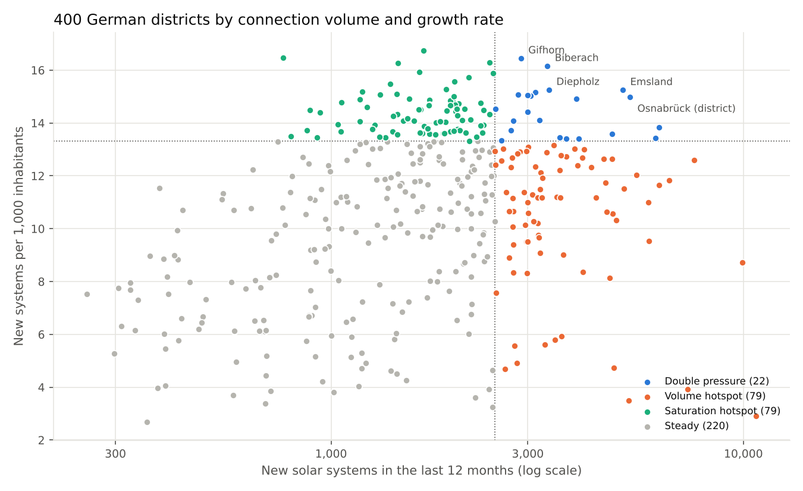
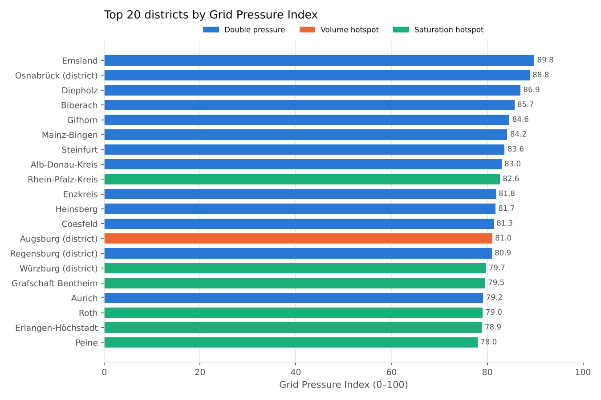
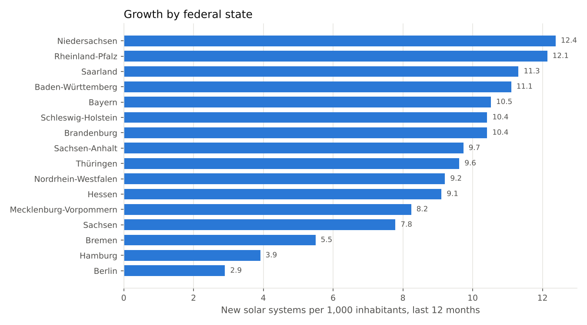

# Grid Pressure Index

**Where are German distribution grids under the most pressure from rooftop solar, balcony solar and home batteries, and which regions should a grid-software sales team talk to first?**

An end-to-end analysis of the official German energy register (Marktstammdatenregister): from 6.4 million solar systems in 10,759 municipalities to a ranked list of 400 districts, four action segments and a sales-ready lead list.

**[Open the interactive dashboard](https://dhrukumar23.github.io/grid-pressure-index/)** · **Power BI report:** [`powerbi/GridPressureIndex.pbip`](powerbi/) · Data as of 2 October 2026



---

## 1. The business question

Every new solar system, balcony plant or battery has to be connected to the local distribution grid, and the grid operator has to check whether the low-voltage grid can take it. In the last 12 months, **810,694 new solar systems** went into operation in Germany, on top of 6.37 million existing ones, including **1.52 million balcony systems** that grid planners have little control over.

That pressure is not spread evenly. A company that sells grid-planning or connection-automation software to grid operators needs to know:

1. **Where** is the pressure highest?
2. **What kind** of pressure is it: a flood of connection requests, or grids filling up quickly?
3. **What** should a sales team say to each region?

## 2. The data

| | |
|---|---|
| Source | Marktstammdatenregister (Federal Network Agency), aggregated per municipality by [solarzahlen.de](https://solarzahlen.de) |
| Export | `Gesamtdatenexport_20261002_26.2.zip`, as of 2 October 2026 |
| Coverage | 10,759 municipalities, 6,374,700 solar systems in operation, 130 GW |
| Licence | Datenlizenz Deutschland – Namensnennung 2.0 (dl-de/by-2-0): commercial and non-commercial reuse allowed with attribution |

**Data checks run on every build** (`quality_report()` in `src/build_index.py`):

- 0 duplicate municipality keys, 0 negative values.
- 17 municipalities have no population figure, mostly uninhabited forest areas plus three places affected by recent boundary changes (Hanau, Uder, Berga-Wünschendorf). Their 4,684 systems are kept in the totals, but per-inhabitant figures cannot be calculated, so the new district of Hanau is not ranked: **400 of 401 districts are ranked**.
- The battery field is filled for 91% of systems; empty fields are not treated as "no battery".
- **A trap in the data:** a city and the rural district around it often share a name (Würzburg city and Landkreis Würzburg, for example). Grouping by name would merge them. The pipeline groups by the official 5-digit district code instead, and a test makes sure this never breaks.

## 3. The method

```
municipalities (10,759)  ──►  quality checks  ──►  districts (400, by official code)
        ──►  4 components scored 0–100  ──►  Grid Pressure Index  ──►  segments  ──►  lead list
```

Each component is converted into a percentile across all districts (0 = lowest, 100 = highest), then weighted:

| Component | What it measures | Why it matters to a grid operator | Weight |
|---|---|---|---|
| Density | Rooftop + balcony systems per 1,000 inhabitants | How full the low-voltage grid already is | 30% |
| Growth rate | New systems per 1,000 inhabitants, last 12 months | How fast it is filling up | 30% |
| Volume | New systems, last 12 months (absolute) | How many connection requests have to be processed | 30% |
| Battery share | Share of systems with a battery on site | Batteries change load profiles and add planning complexity | 10% |

Large ground-mounted solar parks are left out of the density measure, because they usually connect at higher voltage levels, not in the low-voltage grid.

**Is the ranking robust?** With equal weights (25% each) the ranking barely changes: Spearman ρ = **0.95**. The result does not hinge on the chosen weights.

**Segments.** Districts in the top quarter for volume and/or growth rate fall into three hotspot segments; everyone else is "Steady":

| Segment | Rule | Districts | Share of population | Share of new systems |
|---|---|---|---|---|
| Double pressure | top quarter for volume **and** growth rate | 22 | 6.8% | 10.0% |
| Volume hotspot | top quarter for volume only | 79 | 42.0% | 37.5% |
| Saturation hotspot | top quarter for growth rate only | 79 | 11.2% | 16.6% |
| Steady | neither | 220 | 40.0% | 35.9% |

## 4. The results



**Key findings**

1. **The pressure is rural and suburban, not urban.** No independent city ranks higher than #258, and all 50 lowest-ranked districts are cities. Homes with their own roofs drive the growth.
2. **A city and its surrounding district can be worlds apart.** Landkreis Würzburg ranks **#15**, while the city of Würzburg ranks #340. The same pattern holds for Bamberg (#36 vs #375) and Schweinfurt (#40 vs #370).
3. **North-west Germany and the south lead.** Emsland, Landkreis Osnabrück and Diepholz (Lower Saxony) take the top three places. Bavaria has the most districts in the top 50 (14), followed by Lower Saxony (13).
4. **Pressure is concentrated.** The top 20 districts are home to 5.2% of the population but account for 8.0% of all new solar systems in the last 12 months.
5. **By state**, Lower Saxony (12.4 new systems per 1,000 inhabitants) and Rhineland-Palatinate (12.1) grow fastest; Berlin (2.9) and Hamburg (3.9) slowest.



## 5. What to do with it

**A playbook per segment**, so a sales team knows what to lead with:

| Segment | Approach |
|---|---|
| **Double pressure** | **Call first.** Many new connections and fast growth per inhabitant: the operator needs both faster connection checks and low-voltage grid planning. |
| **Volume hotspot** | **Lead with automation.** A large number of connection requests to process: pitch time saved per request and shorter waiting times for customers. |
| **Saturation hotspot** | **Lead with grid planning.** Smaller population but very fast growth per inhabitant: low-voltage feeders fill up, so pitch hosting-capacity analysis and planning transparency. |
| **Steady** | **Nurture.** Re-run the index every quarter and reach out when a district moves into a hotspot segment. |

**A sales-ready lead list:** [`output/lead_list_top30.csv`](output/lead_list_top30.csv) gives the top 30 districts with a data-based talking point and the recommended approach. Example:

> **#1 Emsland (Double pressure):** 5,099 new solar systems in 12 months (15.2 per 1,000 inhabitants, #14 of 400 for growth); 145 rooftop/balcony systems per 1,000 inhabitants; 43% with a battery.

The `grid_operator` column is intentionally left empty: see next steps.

## 6. Power BI report

The same results as a Power BI Project (PBIP), generated from code by [`tools/build_pbip.py`](tools/build_pbip.py), so every table, measure and visual is versioned in Git.

| Page | What it shows |
|---|---|
| **Where the pressure is** | 5 KPI cards, a scatter of all districts (connection volume vs growth per inhabitant, coloured by segment) and growth by state. Slicers for state and segment. |
| **District ranking** | All 400 districts ranked by the index, coloured by segment, with a detail table. |
| **Sales playbook** | Share of new systems vs share of population per segment, the playbook, and the top-30 lead list with talking points. |

**Model:** 4 tables (District, State, Segment, Lead List), 2 relationships and 14 DAX measures in display folders, for example:

```dax
New per 1,000 Inhabitants = DIVIDE ( [New Systems 12M] * 1000, [Population] )
Share of New Systems      = DIVIDE ( [New Systems 12M], CALCULATE ( [New Systems 12M], REMOVEFILTERS () ) )
Top 20 Share of New Systems =
    CALCULATE ( [Share of New Systems], REMOVEFILTERS (), 'District'[Rank] <= 20 )
```

**Open it:** download or clone this repository, open `powerbi/GridPressureIndex.pbip` in Power BI Desktop and click **Refresh**. The model reads the CSV files in `output/` directly from this GitHub repository, so no setup is needed. To work offline, set the `DataFolder` parameter (Transform data → Edit parameters) to your local `output` folder, ending with a backslash.

**Checks:** every report file is validated against Microsoft's published PBIR schemas (`tools/validate_pbir.py`), and a test makes sure every field a visual uses exists in the model.

## 7. Limitations and next steps

**Limitations**
- **Districts are not grid areas.** A grid operator's area rarely matches a district exactly; one operator can serve several districts, and one district can have several operators.
- **Solar only.** Heat pumps and EV chargers add load in the same low-voltage grids but are not in this dataset.
- **Reporting lag.** Registrations for the most recent months are still coming in, so the last few months of growth are slightly understated.
- **Pressure is a proxy.** The index measures what is being connected, not the physical state of each grid.

**Next steps**
1. **Map districts to grid operators.** The full register export links every unit to its grid operator, so the same pipeline can rank operators directly and fill the `grid_operator` column.
2. **Add heat pumps, EV chargers and large batteries** from the register to capture the full load side.
3. **Refresh automatically** every quarter with a scheduled GitHub Actions run, and track which districts move into a hotspot segment.

## 8. Run it yourself

```bash
pip install -r requirements.txt
python src/build_index.py       # data checks, index, segments, lead list -> output/
python src/build_dashboard.py   # charts -> docs/img/, dashboard -> docs/index.html
python tools/build_pbip.py      # Power BI project -> powerbi/
pytest -q                       # 6 tests
```

## Repository map

```
data/raw/            source CSV and its licence text
src/build_index.py   data checks, district aggregation, index, segments, lead list
src/build_dashboard.py, src/dashboard_template.html   charts and the dashboard
output/              district_index.csv, state_summary.csv, lead_list_top30.csv, summary.json
docs/                dashboard (GitHub Pages) and chart images
powerbi/             Power BI Project: TMDL semantic model + PBIR report (3 pages)
tools/               Power BI generator and PBIR schema validator
tests/               tests for aggregation, scoring and ranking stability
```

## Source and credits

Source: solarzahlen.de. Quelle: Marktstammdatenregister, Bundesnetzagentur (dl-de/by-2-0), Daten geändert. https://solarzahlen.de

Analysis by **Dhrukumar Valand**, built with AI assistance (Claude). Independent project; no connection to the Federal Network Agency or any grid operator.
